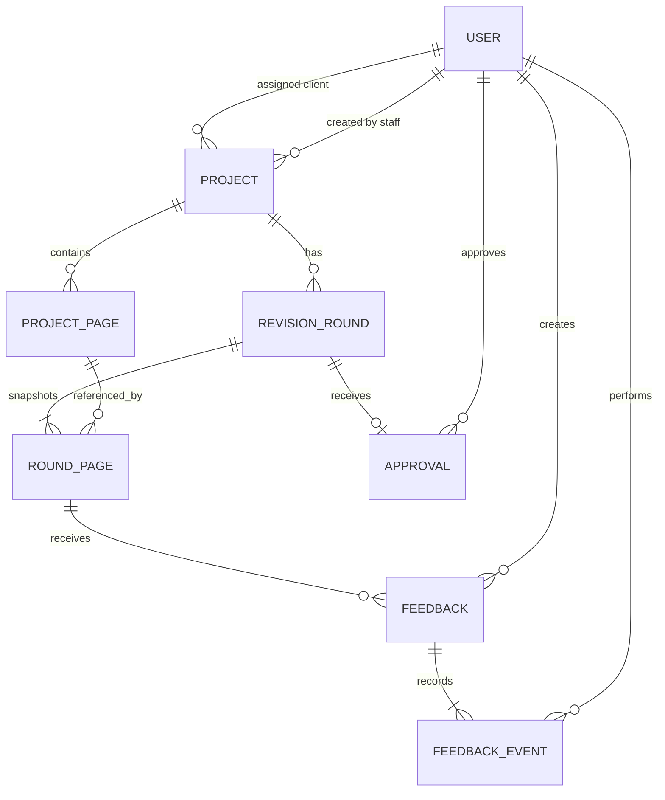

# PRODUCTION.md

# Web-Based Website Revision Tracking and Client Approval System

**Project type:** IGNOU BCA academic project  
**Document:** Master product requirements, technical design, implementation and release plan  
**Version:** 1.0  
**Status:** Implementation blueprint; not a claim that features have been built  
**Last updated:** 17 November 2026  
**Primary stack:** Python, Django, Django REST Framework, Django templates, vanilla JavaScript, HTML, CSS, MySQL  
**Architecture:** Modular monolith, layered responsibilities, same-origin REST APIs

> **Document authority:** This file is the source of truth for planned implementation. Where this document introduces a detailed choice not explicitly settled in earlier discussions, it is a **proposed implementation decision**, not an already approved requirement. Keep the IGNOU-approved synopsis authoritative for academic scope; reconcile discrepancies before final submission.

---

## 1. Executive summary

The Web-Based Website Revision Tracking and Client Approval System is a secure browser-based application for a web development agency and its clients. Agency staff create website projects and list the pages under each project. For every review cycle, staff create a numbered revision round containing fixed preview URLs for pages being reviewed. The designated client reviewer signs in, views the page previews, submits page-specific feedback, and reviews staff responses. Staff resolve feedback; the client may reopen an issue that remains unsatisfactory. When no unresolved feedback remains, the client can formally approve that revision round. The system preserves a chronological, auditable record of revisions, feedback status changes, and approvals.

**This application does not host websites, edit website source code, reconstruct past website versions, or automatically compare screenshots.** A preview is an external URL supplied by staff and recorded as a snapshot for that round. The site at that URL may change later; the system guarantees preservation of the recorded URL and review records, **not** preservation of the external website's visual contents.

### 1.1 Problem

Website reviews are commonly fragmented across email, calls, chats and spreadsheets. Teams struggle to identify which page a comment refers to, which revision was reviewed, whether an issue was resolved, and whether a client approved a particular version. The proposed system centralizes those interactions.

### 1.2 Goals

1. Centralize project and website-page records.
2. Associate every review cycle with a numbered revision round.
3. Record per-page preview URLs and feedback.
4. Track feedback through open, resolved and reopened states.
5. Record who changed what and when.
6. Permit approval only for an eligible, currently open round.
7. Prevent later modification of approved review records.
8. Provide role-specific dashboards, project history and basic reports.
9. Demonstrate sound Django, relational database, REST API, security and testing practices.

### 1.3 Success criteria

- Staff can create a project, its pages and a revision round.
- A client assigned to that project can see only authorized projects and rounds.
- The client can view the recorded page preview links and submit feedback on the correct round page.
- Staff can resolve feedback and clients can reopen it.
- Approval is blocked while open or reopened feedback exists.
- Approval persists the reviewer, round and timestamp atomically.
- Approved rounds and their feedback become read-only.
- A subsequent round does not alter prior-round history or approvals.
- Core security, workflow and API tests pass.
- The app can be demonstrated end to end and deployed with a production-grade configuration.

---

## 2. Scope and boundaries

### 2.1 Required MVP (must implement)

- Secure login/logout and role-based access for **Agency Staff** and **Client Reviewer**.
- Staff user management through Django Admin; one designated client reviewer per project.
- Project creation, viewing, editing and listing.
- Project pages (e.g., Home, About, Services, Contact).
- Numbered revision rounds per project; at most one open round per project.
- Snapshot of reviewed pages and fixed preview URLs in each round.
- Client-facing revision review page with page links and page-specific feedback.
- Feedback creation, listing, resolution, reopening and chronological event history.
- Round approval by its assigned client reviewer only, with unresolved-feedback checks.
- Immutable approved round records at application level.
- Staff and client dashboards, status indicators, history and basic reports.
- Django Admin for administrative support.
- Input validation, authorization, CSRF protection, safe redirects and secure file handling where applicable.
- Automated tests, sample data, installation instructions and deployment checklist.

### 2.2 Explicitly out of scope for MVP

- Website hosting, site-builder/editor, Git integration, code deployment or rollback.
- Automated screenshot capture, visual diffing or archival of external preview sites.
- Multiple client reviewers or voting/quorum approvals for one project.
- Multiple simultaneously open revision rounds for one project.
- Payments, billing, invoices, contracts, electronic signatures or legally certified approvals.
- Real-time chat, WebSockets, push notifications, SMS, WhatsApp or email delivery.
- Mobile native applications.
- React/Next.js, microservices, message queues, Celery, Redis, Docker, Kubernetes or JWT authentication.
- Public anonymous feedback links.
- Complex analytics, time tracking or employee task management.

### 2.3 Optional enhancements, only after MVP is complete

- Feedback screenshot attachments (previously discussed as optional).
- Email notifications for new rounds, feedback and approval.
- CSV/PDF exports of reports.
- Search/filter/pagination enhancements beyond basic server-side pagination.
- Client invitation and password-reset emails.
- Additional agency staff roles or granular permissions.
- Automated preview URL health checks.
- Audit log for administrative configuration changes.

**Scope rule:** Optional features must not delay or compromise MVP completion.

---

## 3. Users and access model

### 3.1 Roles

**Agency Staff**

- Log in to staff-facing screens.
- Create and edit projects, pages and draft/open rounds.
- Assign the project's single client reviewer.
- View project feedback and update issues to resolved.
- View approvals, timelines and reports.
- Cannot approve on behalf of a client through the normal application workflow.

**Client Reviewer**

- Log in to the client portal.
- See only projects to which they are assigned.
- Review rounds and open recorded preview links.
- Add feedback to pages in the currently open round.
- Reopen feedback previously marked resolved in the currently open round.
- Approve an eligible round assigned to them.
- Cannot create projects, change preview URLs, resolve their own feedback as staff, or access other clients' records.

**Administrator (operational superuser)**

- Django superuser for account provisioning, maintenance and troubleshooting.
- This is an operational privilege, **not a third business role** in the workflow.
- Normal client approval rules still apply to the application's approval endpoint; superuser actions in Django Admin must not silently forge client approval.

### 3.2 Authorization matrix

| Action                   | Staff             | Assigned client  | Other client |
| ------------------------ | ----------------- | ---------------- | ------------ |
| List authorized projects | Yes               | Yes              | No           |
| Create/edit project      | Yes               | No               | No           |
| Manage project pages     | Yes               | No               | No           |
| Create/edit open round   | Yes               | No               | No           |
| View round previews      | Yes               | Yes              | No           |
| Create feedback          | No by default     | Yes, open round  | No           |
| Resolve feedback         | Yes, open round   | No               | No           |
| Reopen resolved feedback | No by default     | Yes, open round  | No           |
| Approve round            | No                | Yes, if eligible | No           |
| View project history     | Yes               | Yes              | No           |
| Manage user accounts     | Django Admin only | No               | No           |

**Proposed policy clarification:** Staff do not create client feedback or reopen issues in the MVP; the client owns feedback and reopens it, while staff owns resolution. This creates a clear review trail.

### 3.3 Security invariants

- Every detail endpoint must check object-level access, not merely whether a user is authenticated.
- Querysets must be scoped to the requesting user before object lookup.
- A user cannot grant themselves a staff role by editing an API payload.
- Role is never trusted from browser-supplied form data.
- Project IDs, round IDs and feedback IDs are not authorization tokens.
- Approval actor must be the authenticated, assigned client reviewer.

---

## 4. End-to-end business workflow

### 4.1 Project setup

1. Staff logs in.
2. Staff creates a project with title, description, assigned client reviewer and optional dates.
3. Staff adds website pages, each with a stable page name/slug.
4. Project is available to its assigned client reviewer.

### 4.2 Revision round preparation

1. Staff selects a project.
2. Staff creates the next sequential round number (1, 2, 3...).
3. Staff chooses project pages to review and records each page's preview URL.
4. Staff verifies the links manually and publishes/opens the round.
5. The system enforces one open round per project.
6. Once opened, page membership and preview URLs are frozen for that round. Corrections require withdrawing/recreating the draft before opening, or a new round; do not silently rewrite an already reviewed preview.

### 4.3 Client review

1. Client logs in and opens their project.
2. Client selects the open revision round.
3. Client sees the list of reviewed pages and their recorded URLs.
4. Client opens a preview in a separate tab; external content is not guaranteed to be embedded or archived.
5. Client submits a comment against a specific `RoundPage`.
6. Feedback starts in `open` status and generates a `created` event.

### 4.4 Resolution and reopening

1. Staff reviews an open/reopened feedback item.
2. Staff marks it `resolved` with a resolution note.
3. System creates a `resolved` event with actor and timestamp.
4. Client checks the result; if unsatisfactory, client reopens it with a reason.
5. System changes status to `reopened` and logs a `reopened` event.
6. Staff may resolve it again; every transition is recorded.

### 4.5 Approval

1. Client requests approval for the currently open round.
2. Backend verifies identity, project assignment, current round status and absence of `open`/`reopened` feedback.
3. Backend performs the approval operation in a database transaction with concurrency protection.
4. A single `Approval` record is created and the round is marked `approved`.
5. Approved round pages, feedback, status history and approval are read-only in the normal app.
6. Staff can create a subsequent numbered round if new changes are required; earlier approvals remain tied to earlier rounds.

### 4.6 Important edge cases

- No feedback exists: client may approve after reviewing, if the round contains at least one valid preview page.
- A second approval request: return a conflict or idempotent documented response; never create a duplicate approval.
- Two simultaneous approval/feedback requests: transaction and locking must prevent approval with newly inserted unresolved feedback.
- A client loses project assignment: access to that project is revoked; historical actor attribution remains.
- Project pages change later: old `RoundPage` snapshots retain their labels and URLs.
- An external preview URL changes content or goes offline: historical link is preserved, but external content may be unavailable.
- Attempt to edit an approved round: reject, including via API and ordinary admin forms.
- Round numbering under concurrent requests: serialize creation and enforce database uniqueness.

---

## 5. State machines and rules

### 5.1 RevisionRound status

**Proposed statuses:** `draft`, `open`, `approved`.

- `draft -> open`: staff publishes a valid round with at least one page snapshot.
- `open -> approved`: assigned client approves after validation.
- `approved`: terminal and read-only.
- Only one `open` round per project. A draft may exist alongside an open round, but **a draft cannot be opened until the previous open round is approved**.
- Optional cancellation/rejection of rounds is not included in MVP.

### 5.2 Feedback status

- `open` (created by client)
- `open -> resolved` (staff)
- `resolved -> reopened` (client)
- `reopened -> resolved` (staff)
- No transitions after round approval.
- Empty feedback body, blank resolution notes and blank reopening reasons are rejected.

### 5.3 Approval rules

- A round must be `open` and contain at least one `RoundPage`.
- Actor must be the assigned client reviewer.
- All feedback for that round must be `resolved`; `open` and `reopened` both block approval.
- Approval is attached to **one exact revision round**, not to the project globally.
- One approval per round enforced by a unique database constraint.
- Approval and round status update must commit together.
- Approval timestamp is generated by the server.

### 5.4 Data immutability policy

- `RoundPage` preview URL, page label and page identity snapshot are frozen when the round opens.
- After approval, round, round pages, feedback and events cannot be edited or deleted through the normal application.
- Audit events are append-only.
- Application-level immutability does not mean the database is physically tamper-proof; DB administrators still have privileged access.

---

## 6. Technical architecture

### 6.1 Selected architecture

**Modular monolith:** one Django project, one deployed backend, one relational database, multiple domain-focused Django apps.

**Layered responsibilities inside apps:**

- `urls.py`: URL dispatch.
- `views.py`: HTTP concerns, authentication and orchestration.
- `serializers.py`: input validation and JSON representation.
- `permissions.py`: role and object-level authorization.
- `services.py`: multi-step business operations and transactions.
- `models.py`: persistent domain entities, constraints and small model invariants.
- `selectors.py` (optional): complex reusable read queries only when justified.
- `tests/`: API, authorization, service and model tests.

**Frontend:** Django templates render the application shell and screens. Vanilla JavaScript uses `fetch()` to call same-origin `/api/v1/` endpoints and update UI state. Django session cookies and CSRF protection secure writes.

### 6.2 Request lifecycle

`Browser -> Django URL -> DRF View -> Permission -> Serializer -> Service/ORM -> Database -> Serializer -> JSON -> Browser JS`.

For normal page navigation: `Browser -> Django template view -> HTML -> Browser`.

### 6.3 Why this design

- One deployable service keeps academic implementation and deployment manageable.
- Domain apps separate accounts, projects and review workflow.
- DRF demonstrates a reusable API without forcing React or a separate frontend server.
- Django ORM and migrations provide consistent relational modeling.
- Django Admin speeds up operational user provisioning.
- Service functions isolate complex approval transitions from HTTP views.
- Session authentication avoids unnecessary token storage and JWT complexity.

### 6.4 Technology versions and compatibility

- Python: use the supported Python version already installed in the project's virtual environment, subject to Django compatibility.
- Django: pin a tested stable version in `requirements.txt`; do not blindly upgrade mid-project.
- Django REST Framework: pin a version compatible with the selected Django version.
- Pillow: install **only if** screenshot/image uploads are implemented.
- MySQL driver: use a compatible supported driver for the final MySQL deployment.
- SQLite: local development only if convenient; run the full test suite against MySQL before final release to catch database-specific behavior.
- Exact package versions must be recorded after environment verification, not guessed here.

### 6.5 Authentication and CSRF

- Django session authentication for same-origin pages and APIs.
- Login establishes an authenticated server-side session.
- `fetch()` includes credentials on same-origin requests and sends `X-CSRFToken` on unsafe methods.
- Use Django's CSRF token setup and `SessionAuthentication` correctly.
- Passwords use Django password hashing; never store plaintext passwords.
- No client-accessible API endpoint for changing staff/client roles.

---

## 7. Complete proposed repository structure

```text
college-project/
├── .venv/                         # Local only, ignored by Git
├── .env                           # Local secrets, ignored by Git
├── .env.example                   # Documented variable names, no secrets
├── .gitignore
├── README.md
├── production.md                  # This specification
├── requirements.txt
├── manage.py
├── config/
│   ├── __init__.py
│   ├── settings.py                 # Start simple; split later only if needed
│   ├── urls.py
│   ├── asgi.py
│   └── wsgi.py
├── accounts/
│   ├── __init__.py
│   ├── apps.py
│   ├── admin.py
│   ├── models.py
│   ├── permissions.py
│   ├── serializers.py
│   ├── urls.py
│   ├── views.py
│   ├── migrations/
│   │   └── __init__.py
│   └── tests/
│       ├── __init__.py
│       └── test_permissions.py
├── projects/
│   ├── __init__.py
│   ├── apps.py
│   ├── admin.py
│   ├── models.py
│   ├── serializers.py
│   ├── permissions.py
│   ├── urls.py
│   ├── views.py
│   ├── services.py                # Only if creation/update rules need it
│   ├── migrations/
│   │   └── __init__.py
│   └── tests/
│       ├── __init__.py
│       ├── test_models.py
│       └── test_api.py
├── reviews/
│   ├── __init__.py
│   ├── apps.py
│   ├── admin.py
│   ├── models.py
│   ├── serializers.py
│   ├── permissions.py
│   ├── urls.py
│   ├── views.py
│   ├── services.py                # Round publish, resolve, reopen, approve
│   ├── migrations/
│   │   └── __init__.py
│   └── tests/
│       ├── __init__.py
│       ├── test_workflow.py
│       ├── test_permissions.py
│       ├── test_approval.py
│       └── test_api.py
├── dashboard/
│   ├── __init__.py
│   ├── apps.py
│   ├── urls.py
│   ├── views.py
│   └── tests.py
├── templates/
│   ├── base.html
│   ├── includes/
│   │   ├── navbar.html
│   │   ├── sidebar.html
│   │   ├── messages.html
│   │   └── pagination.html
│   ├── accounts/
│   │   └── login.html
│   ├── staff/
│   │   ├── dashboard.html
│   │   ├── project_list.html
│   │   ├── project_form.html
│   │   ├── project_detail.html
│   │   ├── page_form.html
│   │   ├── round_form.html
│   │   ├── round_detail.html
│   │   └── reports.html
│   ├── client/
│   │   ├── dashboard.html
│   │   ├── project_detail.html
│   │   ├── round_detail.html
│   │   └── history.html
│   └── errors/
│       ├── 403.html
│       ├── 404.html
│       └── 500.html
├── static/
│   ├── css/
│   │   ├── base.css
│   │   ├── components.css
│   │   └── dashboard.css
│   ├── js/
│   │   ├── api.js
│   │   ├── csrf.js
│   │   ├── projects.js
│   │   ├── rounds.js
│   │   ├── feedback.js
│   │   └── ui.js
│   └── images/
├── media/                         # Optional screenshots, never public by default
├── docs/
│   ├── api.md
│   ├── database.md
│   ├── test-plan.md
│   ├── deployment.md
│   ├── user-manual.md
│   ├── er-diagram.md
│   ├── dfd.md
│   └── viva-notes.md
└── scripts/
    └── seed_demo.py              # Or Django management command
```

**Important:** `__init__.py`, `apps.py` and migrations are standard Django app files; they are not optional just because they are not shown in shorter examples. Avoid creating empty `services.py` files where no business service is needed. The directory above is a target structure, not a demand to generate every file on day one.

---

## 8. Data model and schema

The core conceptual entities are **User, Project, ProjectPage, RevisionRound, RoundPage, Feedback, FeedbackEvent, Approval**. The following is a concrete proposed schema for implementation.

### 8.1 User

Use Django's authentication system. **Decision before initial migration:** prefer a custom `accounts.User` subclass of `AbstractUser` with a `role` field (`staff`, `client`) to avoid a painful later user-model swap. Configure `AUTH_USER_MODEL = 'accounts.User'` before the first `migrate`.

| Field                  | Type     | Rules                                           |
| ---------------------- | -------- | ----------------------------------------------- |
| id                     | PK       | Auto-generated                                  |
| username               | string   | Unique, Django auth                             |
| email                  | email    | Required; unique if used for identity           |
| password               | hash     | Django-managed                                  |
| first_name, last_name  | string   | Optional/required per UI policy                 |
| role                   | enum     | `staff` or `client`                             |
| is_active              | boolean  | Django-managed                                  |
| is_staff, is_superuser | boolean  | Django Admin flags; distinct from business role |
| date_joined            | datetime | Django-managed                                  |

**Important:** Django `is_staff` means access to Django Admin; it must not be used as the only check for the business `staff` role. Alternatively, Django Groups can manage business roles, but choose **one authoritative approach**. This blueprint uses `role` for the MVP.

### 8.2 Project

| Field                  | Type         | Rules                                                                 |
| ---------------------- | ------------ | --------------------------------------------------------------------- |
| id                     | PK           | Auto                                                                  |
| title                  | varchar(200) | Required                                                              |
| description            | text         | Optional                                                              |
| client                 | FK -> User   | Required, must have `client` role; PROTECT or controlled reassignment |
| created_by             | FK -> User   | Staff actor                                                           |
| status                 | enum         | `active`, `completed`, `archived` (proposed)                          |
| start_date             | date         | Optional                                                              |
| target_date            | date         | Optional                                                              |
| created_at, updated_at | datetime     | Server-generated                                                      |

`completed` is an informational project status; **round approval is not the same as completing the whole project**.

### 8.3 ProjectPage

| Field                  | Type             | Rules                 |
| ---------------------- | ---------------- | --------------------- |
| id                     | PK               | Auto                  |
| project                | FK -> Project    | Required              |
| name                   | varchar(150)     | Required              |
| slug                   | slug             | Unique within project |
| description            | text             | Optional              |
| display_order          | positive integer | Default 0             |
| is_active              | boolean          | Default true          |
| created_at, updated_at | datetime         | Server-generated      |

Constraint: `UNIQUE(project, slug)`. Do not hard-delete a page referenced by historical round snapshots; deactivate instead.

### 8.4 RevisionRound

| Field       | Type             | Rules                       |
| ----------- | ---------------- | --------------------------- |
| id          | PK               | Auto                        |
| project     | FK -> Project    | Required                    |
| number      | positive integer | Sequential within project   |
| title       | varchar(200)     | Optional descriptive title  |
| notes       | text             | Optional                    |
| status      | enum             | `draft`, `open`, `approved` |
| created_by  | FK -> User       | Staff actor                 |
| created_at  | datetime         | Server-generated            |
| opened_at   | datetime         | Set when published          |
| approved_at | datetime         | Set atomically at approval  |

Constraints: `UNIQUE(project, number)`; enforce at most one `open` round per project with transactional service logic and, where supported, a conditional unique constraint. MySQL partial unique constraints are not uniformly supported, so do not assume a Django conditional `UniqueConstraint` enforces this on MySQL. Use row locking and rechecks against the parent project as the portable primary safeguard.

### 8.5 RoundPage

| Field              | Type                | Rules                                 |
| ------------------ | ------------------- | ------------------------------------- |
| id                 | PK                  | Auto                                  |
| round              | FK -> RevisionRound | Required                              |
| project_page       | FK -> ProjectPage   | Required; must belong to same project |
| page_name_snapshot | varchar(150)        | Captured at round creation            |
| page_slug_snapshot | slug                | Captured at round creation            |
| preview_url        | URL                 | Required, validated                   |
| display_order      | integer             | Default 0                             |
| created_at         | datetime            | Server-generated                      |

Constraint: `UNIQUE(round, project_page)`. Snapshot fields protect history when current project-page labels change. Do not accept cross-project page assignments.

### 8.6 Feedback

| Field                  | Type            | Rules                             |
| ---------------------- | --------------- | --------------------------------- |
| id                     | PK              | Auto                              |
| round_page             | FK -> RoundPage | Required                          |
| created_by             | FK -> User      | Assigned client reviewer          |
| body                   | text            | Required, trimmed, length-limited |
| status                 | enum            | `open`, `resolved`, `reopened`    |
| latest_resolution_note | text            | Optional cached current note      |
| created_at, updated_at | datetime        | Server-generated                  |
| resolved_at            | datetime        | Last resolution time, optional    |

Feedback's round is derived via `round_page.round`; avoid storing a redundant `round_id` unless a demonstrated query requirement justifies it.

### 8.7 FeedbackEvent

| Field       | Type           | Rules                             |
| ----------- | -------------- | --------------------------------- |
| id          | PK             | Auto                              |
| feedback    | FK -> Feedback | Required                          |
| actor       | FK -> User     | Required                          |
| event_type  | enum           | `created`, `resolved`, `reopened` |
| from_status | enum/null      | Previous state                    |
| to_status   | enum           | New state                         |
| note        | text           | Reason or resolution note         |
| created_at  | datetime       | Server-generated                  |

Events are append-only and chronologically ordered by `(created_at, id)`. A later staff edit cannot rewrite prior resolution history.

### 8.8 Approval

| Field       | Type                      | Rules                        |
| ----------- | ------------------------- | ---------------------------- |
| id          | PK                        | Auto                         |
| round       | OneToOne -> RevisionRound | Exactly one approval maximum |
| approved_by | FK -> User                | Assigned client reviewer     |
| note        | text                      | Optional                     |
| approved_at | datetime                  | Server-generated             |

Approval is a **formal workflow record**, not a cryptographic digital signature.

### 8.9 Relationships



### 8.10 Database engineering rules

- Define explicit `on_delete` policies; preserve historical references.
- Add indexes to `Project.client`, `RevisionRound(project, status)`, `RoundPage.round`, `Feedback(round_page, status)`, and event ordering fields as needed.
- Enforce uniqueness at the database layer where possible.
- Validate cross-entity relationships in serializers/services, not only form controls.
- Use timezone-aware timestamps (`USE_TZ = True`) and display in the configured local timezone.
- Use migrations; never manually edit production tables to match models.
- Avoid storing passwords, raw sessions or private tokens in application tables.

---

## 9. REST API contract (v1)

All API routes use `/api/v1/`. Responses are JSON; authenticated same-origin browser sessions are required. Standard DRF pagination is recommended for lists.

### 9.1 Authentication/session

| Method | Path          | Actor         | Purpose                |
| ------ | ------------- | ------------- | ---------------------- |
| GET    | `/login/`     | Anonymous     | Render login page      |
| POST   | `/login/`     | Anonymous     | Django login with CSRF |
| POST   | `/logout/`    | Authenticated | End session            |
| GET    | `/api/v1/me/` | Authenticated | Current user and role  |

**No public registration** in MVP. Accounts are provisioned by administrator.

### 9.2 Projects

| Method | Path                           | Actor        | Purpose                  |
| ------ | ------------------------------ | ------------ | ------------------------ |
| GET    | `/api/v1/projects/`            | Staff/Client | Authorized projects only |
| POST   | `/api/v1/projects/`            | Staff        | Create project           |
| GET    | `/api/v1/projects/{id}/`       | Authorized   | Detail                   |
| PATCH  | `/api/v1/projects/{id}/`       | Staff        | Edit allowed fields      |
| GET    | `/api/v1/projects/{id}/pages/` | Authorized   | List project pages       |
| POST   | `/api/v1/projects/{id}/pages/` | Staff        | Add project page         |
| PATCH  | `/api/v1/pages/{id}/`          | Staff        | Edit page metadata       |

### 9.3 Revision rounds

| Method | Path                            | Actor           | Purpose                                                |
| ------ | ------------------------------- | --------------- | ------------------------------------------------------ |
| GET    | `/api/v1/projects/{id}/rounds/` | Authorized      | Round list                                             |
| POST   | `/api/v1/projects/{id}/rounds/` | Staff           | Create next draft round                                |
| GET    | `/api/v1/rounds/{id}/`          | Authorized      | Round details and page snapshots                       |
| PATCH  | `/api/v1/rounds/{id}/`          | Staff           | Edit draft only                                        |
| POST   | `/api/v1/rounds/{id}/pages/`    | Staff           | Add/update draft page snapshot via validated operation |
| POST   | `/api/v1/rounds/{id}/publish/`  | Staff           | Publish draft to open                                  |
| POST   | `/api/v1/rounds/{id}/approve/`  | Assigned client | Approve eligible open round                            |

### 9.4 Feedback

| Method | Path                                 | Actor           | Purpose                            |
| ------ | ------------------------------------ | --------------- | ---------------------------------- |
| GET    | `/api/v1/rounds/{id}/feedback/`      | Authorized      | Feedback for round                 |
| POST   | `/api/v1/round-pages/{id}/feedback/` | Assigned client | Create feedback on open round page |
| GET    | `/api/v1/feedback/{id}/`             | Authorized      | Feedback details                   |
| POST   | `/api/v1/feedback/{id}/resolve/`     | Staff           | Resolve with note                  |
| POST   | `/api/v1/feedback/{id}/reopen/`      | Assigned client | Reopen with reason                 |
| GET    | `/api/v1/feedback/{id}/events/`      | Authorized      | Chronological status history       |

No arbitrary `PATCH status` endpoint. Status changes must pass through dedicated transition services.

### 9.5 Dashboard and reporting

| Method | Path                             | Actor         | Purpose                          |
| ------ | -------------------------------- | ------------- | -------------------------------- |
| GET    | `/api/v1/dashboard/summary/`     | Authenticated | Role-scoped counts               |
| GET    | `/api/v1/projects/{id}/history/` | Authorized    | Round/feedback/approval timeline |
| GET    | `/api/v1/reports/projects/`      | Staff         | Project and revision summary     |

### 9.6 Example requests and responses

**Create feedback**

```http
POST /api/v1/round-pages/42/feedback/
Content-Type: application/json
X-CSRFToken: <csrf-token>

{"body": "The hero heading overlaps the image on mobile."}
```

**Example `201 Created`:**

```json
{
  "id": 108,
  "round_page": 42,
  "body": "The hero heading overlaps the image on mobile.",
  "status": "open",
  "created_at": "2026-11-17T09:00:00Z"
}
```

**Resolve feedback**

```http
POST /api/v1/feedback/108/resolve/
Content-Type: application/json
X-CSRFToken: <csrf-token>

{"note": "Adjusted responsive spacing and verified the mobile layout."}
```

**Approval rejection example:**

```json
{
  "code": "unresolved_feedback",
  "detail": "Resolve all open or reopened feedback before approval.",
  "unresolved_count": 2
}
```

### 9.7 API conventions

- `200` successful reads/updates, `201` creation, `204` optional no-content success.
- `400` invalid input, `401` unauthenticated where appropriate, `403` forbidden, `404` not found, `409` workflow conflict.
- For session-authenticated DRF, unauthenticated responses may be `403` depending on authentication classes; document and test actual behavior rather than assuming all endpoints return `401`.
- Return field-level serializer errors for invalid data.
- Use consistent timestamps in ISO 8601 format.
- Never expose other clients' records in list or nested responses.
- Pagination, ordering and allowed filters must be bounded.
- Treat submitted IDs and preview URLs as untrusted.

---

## 10. Frontend pages and UX requirements

### 10.1 Public/auth pages

- Login: username/email policy consistent with configured authentication, password, errors, CSRF.
- Logout: POST action, session invalidation and redirect.
- 403, 404 and 500 pages with non-sensitive messages.

### 10.2 Staff screens

1. **Dashboard:** total projects, active projects, open rounds, unresolved feedback, recently approved rounds.
2. **Project list:** title, client, status, current round, updated date, search/filter.
3. **Create/edit project:** validated project metadata and client assignment.
4. **Project detail:** summary, page list, revision timeline, current status.
5. **Manage pages:** add/edit/deactivate page, order pages.
6. **Create round:** draft metadata, selected pages, preview URLs, publish validation.
7. **Round detail:** page snapshots, feedback grouped by page, status and approval information.
8. **Feedback resolution:** view comment, add resolution note, mark resolved.
9. **Reports/history:** round-by-round outcomes, unresolved count, approval timestamps.

### 10.3 Client screens

1. **Dashboard:** assigned projects, open review rounds, pending issues, recent approvals.
2. **Project detail:** project description, pages and round history.
3. **Round review:** revision number, page links, feedback form for each page, issue statuses.
4. **Feedback timeline:** original comment, resolution note, reopen reason, actors and dates.
5. **Approval action:** only enabled when backend rules pass; show confirmation and final approval record.
6. **History:** approved rounds and read-only review records.

### 10.4 UI behavior

- Responsive layouts for desktop, tablet and mobile.
- Consistent navigation and role-appropriate menus.
- Visible loading, empty, error and success states.
- Disabled submit buttons during pending writes, while still handling duplicate server requests.
- Clear feedback status labels; do not rely on color alone.
- Accessible labels, focus states, keyboard navigation and adequate contrast.
- Confirm consequential actions such as round publishing and approval.
- Display external preview links as external links with safe `rel="noopener noreferrer"`.
- Escape user-generated feedback; never inject it via unsafe `innerHTML`.
- Render server validation errors near relevant fields.

### 10.5 Frontend integration pattern

- Django renders initial HTML and session-aware navigation.
- `static/js/api.js` wraps `fetch`, JSON parsing and error handling.
- `static/js/csrf.js` retrieves the CSRF token safely.
- Feature scripts load and update project/round/feedback components.
- Keep business authorization and approval logic on the server, not in JavaScript.

---

## 11. Business validation and security

### 11.1 Input validation

- Project title required and length-limited.
- Page name/slug required; slug unique within project.
- Preview URL must use `https://` or, if explicitly allowed for local demos, `http://`; reject `javascript:`, `data:`, `file:` and control characters.
- Feedback text and notes must be nonblank and length-limited.
- Date fields must be valid; target date cannot precede start date if both are set.
- User assigned as client must have client role.
- RoundPage's ProjectPage must belong to the same project as the round.
- Prevent editing snapshots after publish and all approved records.

### 11.2 Security controls

- Django password hashers, session security and CSRF middleware.
- `DEBUG=False` in production; secret key stored in environment variables.
- `ALLOWED_HOSTS` and trusted CSRF origins explicitly configured.
- HTTPS, secure session/CSRF cookies and HSTS once HTTPS is stable.
- Restrictive CORS: same-origin by default; no wildcard credentialed cross-origin access.
- Django ORM queries and parameterized database operations; no string-concatenated SQL.
- Django template autoescaping; safe DOM text insertion in JS.
- Object-level permission checks on every nested resource.
- Prevent open redirects after login.
- No sensitive error traces in user-facing responses.
- Limit login attempts through a documented rate-limit mechanism if deployment permits; at minimum monitor failures and avoid user enumeration.
- Rate-limit expensive or spam-prone API writes where feasible.
- Secure file uploads if optional screenshots are enabled: size/type checks, random filenames, authenticated download, no executable uploads, storage outside public static paths.
- Do not fetch arbitrary user-provided preview URLs server-side in MVP, avoiding an unnecessary SSRF surface.
- Configure secure HTTP headers and run `python manage.py check --deploy`.

### 11.3 Concurrency and transaction design

**Approval race condition is critical.** A naive `if no feedback: approve()` can race against a simultaneous feedback creation. Proposed solution:

1. Use `transaction.atomic()`.
2. Lock the parent `Project` row with `select_for_update()` for all operations that create/publish rounds, add feedback or approve rounds.
3. Re-fetch and validate the target round and its current state inside that transaction.
4. For approval, check unresolved feedback while holding the shared project lock.
5. Create `Approval` and mark round approved in the same transaction.
6. Enforce `Approval.round` uniqueness at DB level.
7. Test on MySQL, because SQLite locking behavior differs.

Lock ordering must remain consistent across all workflow services to reduce deadlocks. Catch database integrity conflicts and return a meaningful `409` rather than a raw traceback.

### 11.4 Privacy and retention

- Store only necessary project, reviewer and feedback information.
- Never place passwords or session secrets in reports.
- Backups are access-controlled and encrypted where supported.
- Keep approved review history for the project's required retention period; establish an explicit retention/deletion policy before real-client use.
- Avoid using actual client confidential data in academic demos; seed fictional accounts and projects.

---

## 12. Reports and dashboard calculations

### 12.1 Staff metrics

- Total projects and projects by status.
- Number of open revision rounds.
- Number of approved rounds.
- Unresolved feedback count (`open` + `reopened`).
- Feedback count per project and round.
- Latest approval date and reviewer.

### 12.2 Client metrics

- Number of assigned projects.
- Open rounds awaiting review.
- Unresolved feedback on assigned projects.
- Approved round history.

### 12.3 Reporting rules

- All client counts must be filtered to assigned projects.
- Date filters use timezone-aware boundaries.
- Reports must distinguish **round approved** from **project completed**.
- Empty reports display a meaningful message, not broken charts.
- Basic HTML tables are sufficient; CSV/PDF export is optional.

---

## 13. Testing strategy

### 13.1 Test categories

- Model and database constraint tests.
- Serializer validation tests.
- Service/business workflow tests.
- API authentication and object permission tests.
- Template navigation and role visibility tests.
- Integration tests for complete review/approval lifecycle.
- Responsive and accessibility manual tests.
- Deployment smoke tests on production-like MySQL.

### 13.2 Mandatory test scenarios

| ID  | Scenario                                           | Expected result                              |
| --- | -------------------------------------------------- | -------------------------------------------- |
| T01 | Staff creates valid project                        | Project persisted                            |
| T02 | Client tries to create project                     | Forbidden                                    |
| T03 | Client accesses another client's project           | Denied without data leakage                  |
| T04 | Staff adds project page                            | Page appears in project                      |
| T05 | Duplicate page slug in same project                | Validation/constraint error                  |
| T06 | Staff creates first draft round                    | Number 1                                     |
| T07 | Staff publishes round with no pages                | Rejected                                     |
| T08 | Staff attempts to open second round while one open | Rejected                                     |
| T09 | Client submits feedback to own open round          | Created with event                           |
| T10 | Client submits feedback to unrelated round         | Denied                                       |
| T11 | Staff resolves feedback with note                  | Resolved event saved                         |
| T12 | Client reopens resolved feedback                   | Reopened event saved                         |
| T13 | Client approves with open feedback                 | Rejected                                     |
| T14 | Client approves with reopened feedback             | Rejected                                     |
| T15 | Client approves with all feedback resolved         | Approval created atomically                  |
| T16 | Client approves with no feedback                   | Allowed for valid open round                 |
| T17 | Staff tries to approve                             | Forbidden                                    |
| T18 | Second approval request                            | No duplicate approval                        |
| T19 | Any actor edits approved round data                | Rejected                                     |
| T20 | New round after approval                           | New sequential number; old history unchanged |
| T21 | Invalid preview URL scheme                         | Rejected                                     |
| T22 | Cross-project RoundPage assignment                 | Rejected                                     |
| T23 | Feedback creation races with approval              | No inconsistent approved+unresolved state    |
| T24 | Concurrent round creation                          | No duplicate round number                    |
| T25 | Logout then access protected page                  | Redirect/deny                                |
| T26 | Unsafe POST without CSRF                           | Rejected in real CSRF-enforced client        |
| T27 | Malicious HTML in feedback                         | Displayed as text, not executed              |
| T28 | Client dashboard/report                            | Contains only authorized project data        |
| T29 | Preview URL later changes externally               | Stored historical URL remains unchanged      |
| T30 | Database backup restored to test environment       | Application and records recover              |

### 13.3 Test fixtures

- One staff user, two distinct client users.
- Two projects with different assigned clients.
- At least three project pages per project.
- One approved round and one open round across different projects.
- Feedback in `open`, `resolved` and `reopened` states.
- Event histories and one approval record.

### 13.4 Definition of done for each feature

- Model/migration or schema change reviewed.
- Authorization and validation implemented.
- API behavior documented.
- Relevant automated tests pass.
- Frontend works on desktop and mobile.
- Error/empty/loading states handled.
- No credentials or generated environment files committed.

---

## 14. Local development setup (Windows 10 / PowerShell)

### 14.1 Prerequisites

- Supported Python version and `py` launcher.
- VS Code and Git.
- MySQL available for final validation; SQLite can be used first.
- Browser and terminal.

### 14.2 Create environment

```powershell
mkdir college-project
cd college-project
py -m venv .venv
.\.venv\Scripts\Activate.ps1
python -m pip install --upgrade pip
python -m pip install django djangorestframework
python -m django startproject config .
python manage.py startapp accounts
python manage.py startapp projects
python manage.py startapp reviews
python manage.py startapp dashboard
```

**PowerShell note:** If activation is blocked by policy, use a permitted process-scoped execution-policy adjustment according to local security policy, or invoke `.\.venv\Scripts\python.exe` directly. Once activated, `python` and `pip` refer to the virtual environment; no need to type the full interpreter path for every command.

### 14.3 First migration order

1. Configure `AUTH_USER_MODEL` and register apps **before first migrate**.
2. Define the custom User model.
3. Run `python manage.py makemigrations accounts`.
4. Run `python manage.py migrate`.
5. Create an administrator with `python manage.py createsuperuser`.
6. Run `python manage.py runserver` and verify login/Admin.
7. Add other models and migrations incrementally.

### 14.4 Daily development commands

```powershell
.\.venv\Scripts\Activate.ps1
python manage.py runserver
python manage.py makemigrations
python manage.py migrate
python manage.py test
python manage.py check
python -m pip freeze > requirements.txt
```

Freeze only after verifying a working set of dependencies; review the file before committing. Use `.env.example` for non-secret configuration names.

### 14.5 Git hygiene

Ignore `.venv/`, `.env`, `__pycache__/`, `*.pyc`, local SQLite databases, user uploads, logs and collected static output. Commit source code, migrations, tests, docs and reviewed dependency locks. Use short feature branches and meaningful commits.

---

## 15. Implementation roadmap and checkpoints

### Phase 0 — Requirements and design

- [ ] Confirm academic synopsis alignment and project title.
- [ ] Review functional scope and out-of-scope items.
- [ ] Draw ER diagram, context DFD, level-1 DFD and workflow flowchart.
- [ ] Agree on statuses, permissions and database fields.
- [ ] Finalize wireframes and API naming conventions.

**Exit:** approved blueprint and diagrams.

### Phase 1 — Foundation

- [ ] Create repository, virtual environment and Django project.
- [ ] Install Django/DRF; pin compatible versions.
- [ ] Create custom User before initial migration.
- [ ] Configure settings, templates, static files and database.
- [ ] Configure Django Admin, login/logout, sessions and CSRF.
- [ ] Add base template, navigation and error pages.

**Exit:** working authenticated shell.

### Phase 2 — Accounts and permissions

- [ ] Implement staff/client role policy.
- [ ] Provision test users in Django Admin.
- [ ] Create `/api/v1/me/`.
- [ ] Restrict role-specific pages and API querysets.
- [ ] Test cross-client isolation.

**Exit:** secure role-aware access.

### Phase 3 — Projects and pages

- [ ] Implement Project and ProjectPage models and migrations.
- [ ] Create serializers, API views and permissions.
- [ ] Build staff project list/form/detail and page management.
- [ ] Build client project list/detail read views.
- [ ] Test ownership, validation and historical-page safeguards.

**Exit:** staff can create projects/pages and client can view assigned projects.

### Phase 4 — Revision rounds

- [ ] Implement RevisionRound and RoundPage models.
- [ ] Implement sequential numbering and concurrency safety.
- [ ] Create draft and publish services.
- [ ] Enforce one open round per project.
- [ ] Freeze page snapshots on publish.
- [ ] Build staff round form and client round review page.

**Exit:** clients can view immutable open-round preview links.

### Phase 5 — Feedback lifecycle

- [ ] Implement Feedback and FeedbackEvent models.
- [ ] Implement client feedback creation.
- [ ] Implement staff resolve and client reopen services.
- [ ] Build feedback list, forms, status badges and event timeline.
- [ ] Test transition rules, permissions and history integrity.

**Exit:** complete feedback resolution/reopen workflow.

### Phase 6 — Approval

- [ ] Implement Approval model and unique constraint.
- [ ] Implement transactional approval service.
- [ ] Enforce unresolved feedback blocking and actor validation.
- [ ] Enforce approved-round read-only behavior.
- [ ] Add approval confirmation and history UI.
- [ ] Test concurrency, duplicate requests and new-round behavior.

**Exit:** fully working revision-specific approval.

### Phase 7 — Dashboards and reports

- [ ] Implement role-scoped summary API.
- [ ] Staff and client dashboard cards.
- [ ] Project/round history and simple reports.
- [ ] Search, filtering and pagination where needed.
- [ ] Verify report counts and isolation.

**Exit:** useful review status visibility.

### Phase 8 — Hardening and QA

- [ ] Complete test matrix and fix failures.
- [ ] Validate responsive layouts and keyboard navigation.
- [ ] Test CSRF, XSS, unauthorized access and invalid input.
- [ ] Verify transactional behavior on MySQL.
- [ ] Add demo seed data and user manual.
- [ ] Review security settings and secrets handling.

**Exit:** release candidate.

### Phase 9 — Deployment and submission

- [ ] Provision hosting compatible with Django and MySQL.
- [ ] Set environment variables, HTTPS and allowed hosts.
- [ ] Apply migrations and collect static files.
- [ ] Configure application server and static/media serving.
- [ ] Run smoke tests, backups and restore drill.
- [ ] Capture screenshots, diagrams and test results.
- [ ] Complete IGNOU report, presentation and viva preparation.

**Exit:** deployed demonstration and academic submission package.

---

## 16. Deployment and operations

### 16.1 Production hosting requirements

Choose a host that supports persistent Python/Django processes (or WSGI/ASGI integration), environment variables, MySQL access, HTTPS, logs and backups. Do **not** assume ordinary PHP-only shared hosting can run Django without checking provider capabilities.

### 16.2 Production configuration

- Set `DEBUG=False`, secure `SECRET_KEY`, `ALLOWED_HOSTS`, `CSRF_TRUSTED_ORIGINS`.
- Configure MySQL credentials via environment variables.
- Run migrations during controlled deployment.
- Configure `STATIC_ROOT` and `collectstatic`; serve static assets via web server or suitable middleware.
- Configure private media storage if attachments are added.
- Set secure cookies and HTTPS redirect appropriately behind a trusted proxy.
- Configure error logging without leaking secrets.
- Run `manage.py check --deploy` and test critical flows.

### 16.3 Backups and recovery

- Back up database on a defined schedule; include uploaded media if enabled.
- Store backups separately from the running application.
- Document restore commands and test restore into a non-production environment.
- Before schema changes, back up data and confirm rollback/forward-fix strategy.
- Do not rely on reversing migrations alone to restore lost data.

### 16.4 Monitoring

- Monitor HTTP 5xx errors, failed login patterns, database connectivity and storage usage.
- Retain application and web-server logs with sensible rotation.
- Check health after deployment and verify the login -> review -> approval journey.

### 16.5 Deployment smoke checklist

- [ ] Homepage/login loads via HTTPS.
- [ ] Staff login works.
- [ ] Client login works.
- [ ] Client cannot see another client's project.
- [ ] Staff can create a project and round.
- [ ] Client can create feedback.
- [ ] Staff can resolve feedback.
- [ ] Client can reopen and then approve after resolution.
- [ ] Static assets load.
- [ ] No `DEBUG` tracebacks or exposed secrets.
- [ ] Database backup succeeds.

---

## 17. Academic deliverables

The final IGNOU submission should follow the currently applicable official format and supervisor guidance; verify the latest required headings, page counts and signatures rather than assuming a generic template is sufficient.

### 17.1 Synopsis / proposal

- Project title and introduction.
- Problem statement and objectives.
- Existing process and limitations.
- Proposed solution and scope.
- User roles and functional requirements.
- Hardware/software requirements.
- Technology justification.
- Feasibility: technical, operational, economic and schedule.
- High-level design, ER diagram and DFDs.
- Implementation plan and expected outcomes.

### 17.2 Final project report

- Cover page, certificate/declaration/acknowledgements as officially required.
- Abstract and table of contents.
- Introduction, problem statement and objectives.
- Requirement analysis and feasibility study.
- System architecture and module descriptions.
- Database design with ER diagram, tables and relationships.
- DFD context/level 1 and process flowcharts.
- UI wireframes/screenshots.
- Implementation details and representative code explanation.
- Testing methodology, test cases and results.
- Security, limitations and future enhancements.
- Conclusion, references and appendices.
- Installation guide, demo credentials for fictional users and API examples.

### 17.3 Diagrams to create

1. System context diagram: Staff, Client, System.
2. DFD Level 0: overall information flow.
3. DFD Level 1: project management, revision management, feedback, approval and reporting.
4. ER diagram: eight core entities and cardinalities.
5. Use-case diagram: staff and client actions.
6. Activity diagram: feedback resolution and reopening.
7. Activity/sequence diagram: transactional approval.
8. Component architecture diagram: browser, Django/DRF, apps and database.
9. Optional deployment diagram: browser, web server, Django and MySQL.

### 17.4 Viva demonstration script

1. Explain the problem and two roles.
2. Show staff login and project/page creation.
3. Create and publish a numbered round with preview links.
4. Log in as the assigned client and add page-specific feedback.
5. Show that approval is blocked by unresolved feedback.
6. Log in as staff and resolve the issue.
7. Reopen it as client, then resolve again as staff.
8. Approve the round as client.
9. Show immutable history and the approval record.
10. Create a later round and show that prior approval remains unchanged.
11. Explain DRF endpoints, models, foreign keys, sessions, CSRF and tests.

---

## 18. Functional requirements traceability

| ID    | Requirement                                     | Primary module    | Verification      |
| ----- | ----------------------------------------------- | ----------------- | ----------------- |
| FR-01 | Authentication and role-based access            | accounts          | T02, T03, T25     |
| FR-02 | Project and page management                     | projects          | T01, T04, T05     |
| FR-03 | Numbered revision rounds and preview snapshots  | reviews           | T06-T08, T21, T22 |
| FR-04 | Page-specific feedback                          | reviews           | T09, T10          |
| FR-05 | Feedback resolution, reopening and audit events | reviews           | T11, T12          |
| FR-06 | Round-specific client approval                  | reviews           | T13-T19, T23      |
| FR-07 | Project/revision history and reports            | dashboard/reviews | T20, T28, T29     |
| FR-08 | Security, validation and data integrity         | all               | T03, T21-T30      |

### 18.1 Non-functional requirements

- **NFR-01 Security:** authentication, authorization, CSRF, secure sessions and safe output.
- **NFR-02 Integrity:** transactional approval, unique constraints, audit trail and immutable approved rounds.
- **NFR-03 Usability:** responsive interface, accessible forms and clear workflow statuses.
- **NFR-04 Maintainability:** domain modules, migrations, tests and documented APIs.
- **NFR-05 Reliability:** backup/restore plan, controlled deployments and error logging.
- **NFR-06 Performance:** bounded list endpoints, indexes and avoidance of N+1 queries; measure performance on realistic demo data before setting numeric SLAs.
- **NFR-07 Compatibility:** modern desktop/mobile browsers and supported Python/Django/MySQL versions.
- **NFR-08 Auditability:** append-only feedback event history and attributable approval records.

---

## 19. Risks and mitigations

| Risk                                | Impact               | Mitigation                                          |
| ----------------------------------- | -------------------- | --------------------------------------------------- |
| Overengineering                     | Missed deadline      | Build MVP first; defer optional features            |
| Custom user model added too late    | Difficult migrations | Define before first migrate                         |
| Client data leak                    | High                 | Queryset scoping and object permission tests        |
| Approval race condition             | High                 | Shared project row lock + transaction + constraints |
| Preview URL changes externally      | Review ambiguity     | Explain limitation; retain URL snapshot             |
| SQLite/MySQL differences            | Production defects   | Run workflow tests on MySQL before release          |
| Shared hosting lacks Django support | Deployment failure   | Verify WSGI/ASGI support early                      |
| Poor audit integrity                | Unreliable history   | Append-only events and approved-record guards       |
| Unclear academic scope              | Submission mismatch  | Reconcile with approved synopsis                    |
| Hard-coded credentials              | Security exposure    | Environment variables and `.gitignore`              |

---

## 20. Decisions, assumptions and open verification items

### 20.1 Previously established scope

- Two business roles: agency staff and a single designated client reviewer per project.
- Projects, pages, numbered revision rounds, page-specific preview URLs, feedback, resolve/reopen, approval, history and reports.
- At most one open revision round per project.
- Approval blocked by unresolved/reopened feedback and tied to a specific round.
- Approved review records read-only.
- Existing preview links, not website hosting or historical visual reconstruction.
- Python/Django backend, HTML/CSS/JavaScript frontend, MySQL planned database.

### 20.2 Architecture choices adopted for this blueprint

- Django REST Framework for same-origin JSON APIs.
- Modular monolith with `accounts`, `projects`, `reviews` and `dashboard` apps.
- Django templates plus vanilla JS, no React in MVP.
- Session auth with CSRF, no JWT.
- SQLite for initial local development and MySQL validation/final deployment.
- Custom User model before migrations.
- Draft -> open -> approved revision lifecycle.
- Staff resolves; client creates/reopens feedback and approves.
- One approval per round, no public registration.

### 20.3 Verify before finalizing implementation

- Exact IGNOU synopsis title, approved feature list and supervisor-specific format.
- Whether the final demo must use MySQL locally as well as in deployment.
- Supported Python/Django/DRF versions in the current virtual environment.
- Deployment provider's actual Python and database capabilities.
- Whether screenshots are required or merely optional.
- Whether a project can be archived with an open round; proposed policy: block archival until no round is open.
- Whether changing the assigned client is allowed after a round has opened; proposed policy: block reassignment once review history exists, except via explicit audited admin procedure.
- Whether a published round with zero feedback may be approved; proposed policy: yes.

**Change control:** When any item above changes, update this document, relevant schema/API diagrams and tests in the same feature branch.

---

## 21. Final acceptance checklist

- [ ] Required modules implemented and integrated.
- [ ] Eight core entities modeled with correct relationships.
- [ ] Role permissions enforced in backend and tested.
- [ ] Revision numbering and one-open-round rule reliable.
- [ ] Preview snapshots fixed after publishing.
- [ ] Feedback events preserve actor and timestamp.
- [ ] Resolve/reopen transitions validated.
- [ ] Approval is round-specific, transactional and blocked by unresolved feedback.
- [ ] Approved history is read-only.
- [ ] Staff and client dashboards and reports work.
- [ ] Responsive and accessible basic UI.
- [ ] Security checks, tests and MySQL validation completed.
- [ ] Production settings and backup/restore verified.
- [ ] README, API docs, diagrams, test plan and user manual completed.
- [ ] Academic report, screenshots and viva demonstration prepared.

---

## 22. Implementation principles

1. Build one vertical feature at a time: model -> migration -> permission -> serializer -> service -> API -> frontend -> test.
2. Never use a frontend-only check as a security control.
3. Prefer clear Django conventions over unnecessary abstractions.
4. Never silently mutate historical approved review data.
5. Treat all client-supplied data as untrusted.
6. Keep the project demonstrable at every phase.
7. Record implementation changes in this document rather than letting the code and specification drift apart.
8. Finish the academic MVP before optional production enhancements.

**End of master production specification.**
